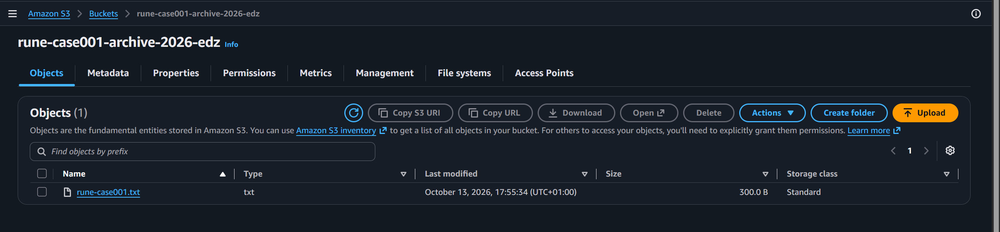
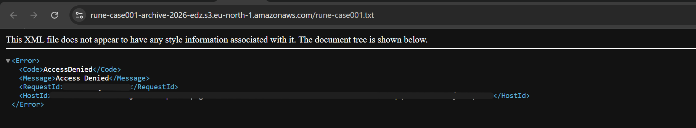
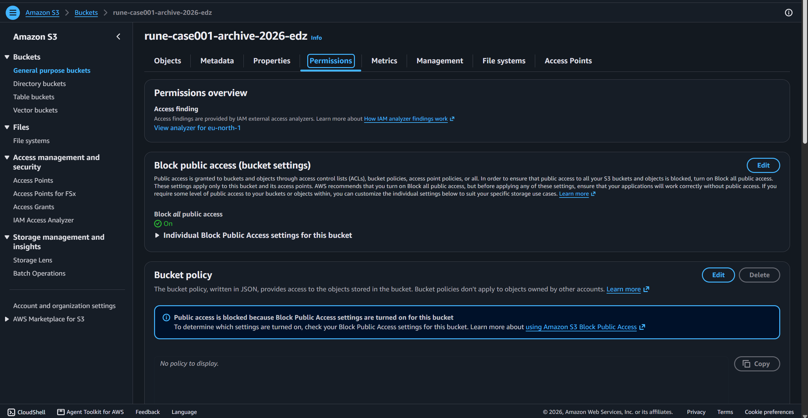
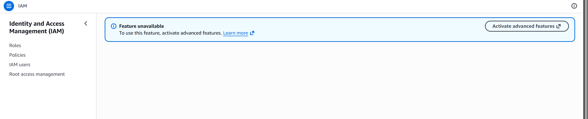

# Project RUNE - The Digital Mystery Archives

**A Cloud Security Learning Project exploring AWS troubleshooting through hands-on investigations.**

**Status:** Case 001: Phase 1 Completed | IAM Investigation Planned

## Overview

Project RUNE is a beginner-led cloud security and technical support learning project built around investigative mystery cases.

Each case introduces a technical problem, examines available evidence, investigates possible causes and documents findings from an authorised lab environment.

The project combines practical cloud learning, structured troubleshooting and investigative storytelling.

## Case 001 - The Locked Archive

**Scenario:** A user attempts to retrieve a file stored in Amazon S3 but receives an AccessDenied error.

**Investigation question:** Why is access denied, and is this an actual configuration problem or expected security behaviour?

## Learning Objectives:

- Understand Amazon S3 buckets and object storage.
- Distinguish anonymous access from authenticated access.
- Examine S3 Block Public Access and bucket policies.
- Develop a structured approach to investigating access errors.
- Explore AWS IAM and the principle of least privilege in future experiments.

## Lab Environment

- Cloud platform: Amazon Web Services (AWS)
- Service: Amazon S3
- Region: Europe (Stockholm), eu-north-1
- Test bucket: rune-case001-archive-2026-edz
- Test object: rune-case001.txt
- Documentation: Markdown and GitHub

All experiments use an authorised AWS account and non-sensitive sample data.

## Investigation and Findings

### Step 1 - Create the Archive

1. Created a private Amazon S3 bucket and uploaded a sample text file.

2. **Result:** The file was successfully stored in S3.

### Step 2 - Reproduce AccessDenied

1. Opened the object's HTTPS URL directly in a browser without an authenticated S3 request.

2. **Observed result:** Amazon S3 returned an XML response containing AccessDenied.

### Step 3 - Verify Authenticated Access

1. Returned to the AWS Management Console and downloaded the same object through the authenticated session.

2. **Observed result:** The file downloaded successfully.

### Step 4 - Examine Bucket Permissions

1. Reviewed the bucket's Permissions tab.

2. **Observed configuration:**

   - Block all public access: **On**
   - Bucket policy: **No policy configured**

### Step 5 - Interpret the Evidence

1. The test showed that anonymous retrieval was denied while access through the authenticated AWS Console session succeeded.

2. This is consistent with the bucket's private configuration and Amazon S3's default access-control behaviour.

3. **Conclusion:** The observed AccessDenied response is expected security behaviour, not evidence that the bucket is misconfigured.

4. This investigation does not yet demonstrate an IAM user or role being denied access because of a missing or incorrect identity-based policy.

## Investigation Limitation

The AWS IAM Policy Simulator was unavailable under the current account configuration.

No account upgrade was performed, and no public access settings were disabled to bypass the restriction.

A controlled IAM permissions investigation remains future work.

## Security Lessons Learned

- An AccessDenied response does not automatically mean a system is broken.
- Authentication and authorisation are different concepts.
- A direct S3 object URL does not automatically grant access to a private object.
- Access-control settings should be investigated before attempting changes.
- Troubleshooting should preserve secure defaults rather than introduce unnecessary permissions.

## Project Roadmap

### Phase 1 - S3 Access Investigation (Completed)

- [x] Create the GitHub repository.
- [x] Create a private S3 bucket and upload a test object.
- [x] Reproduce and record an anonymous AccessDenied response.
- [x] Verify access through the authenticated AWS Console.
- [x] Examine bucket public-access settings and bucket policy.
- [x] Document the initial investigation and findings.
- [x] Publish reviewed and redacted evidence screenshots.

### Phase 2 - IAM Permissions Investigation (Planned)

- [ ] Set up a suitable authorised IAM testing environment.
- [ ] Reproduce an access denial involving an authenticated IAM identity.
- [ ] Investigate identity-based permissions and identify the cause.
- [ ] Test a least-privilege solution and document the results.

### Phase 3 - Interactive Mystery Experience (Future Development)

- [ ] Develop an interactive mystery investigation interface.
- [ ] Explore additional cloud security and technical support cases.

## Learning Approach

This project is being developed alongside my Higher Diploma in Science in Computing at the National College of Ireland.

The focus is on practical experimentation, understanding why technical issues occur and communicating technical findings clearly.

Project RUNE is a work in progress, with each case expanded as new technical skills and evidence become available.
